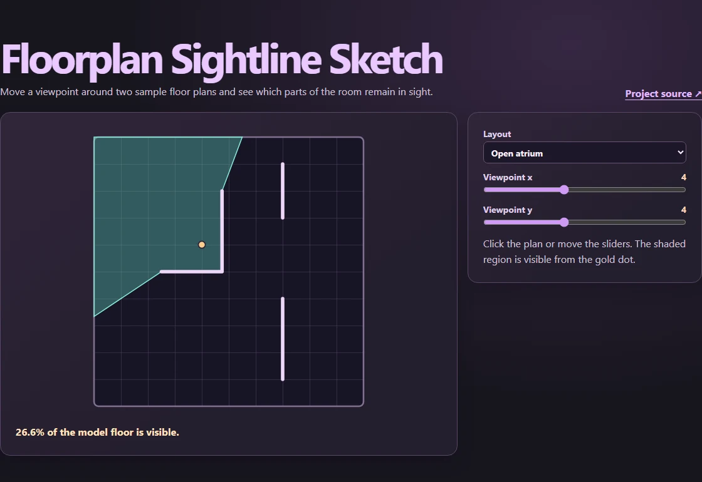

# Floorplan Sightline Sketch

Move a viewpoint around two sample floor plans and see which parts of the room remain in sight.

[Open the browser app](https://surfingcoder.com/apps/floorplan-sightline-sketch/)

## Run locally

Run the following command in this repository and open [localhost:8000](http://localhost:8000).

    python -m http.server 8000

Select a preset and move the viewpoint. The program casts rays around the partition endpoints and clips them at the closest wall. Sightlines use a flat 10 × 10 room with opaque line segments.

## Verify

Run the following command with Node.js 22 or newer.

    node --test
